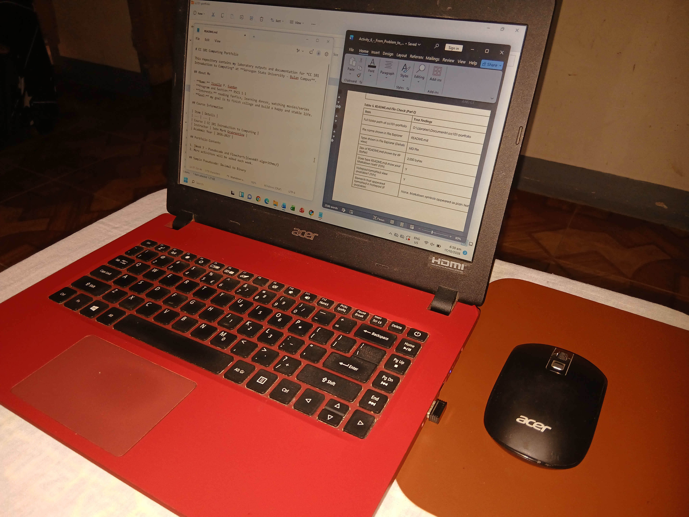

# CC 101 Computing Portfolio
 
This repository contains my laboratory outputs and documentation for *CC 101 Introduction to Computing* at **Sorsogon State University – Bulan Campus**.
 
## About Me
 
- **Name:** [Jiselle P. Fuedan]
- **Program and Section:** BSCS 1-[1]
- **Interests:** [reading fanfics, learning dances, watching movies/series]
- **Goal:** [my goal is to finish college and build a happy and stable life.]
 
## Course Information
 
| Item | Details |
| --- | --- |
| Course | CC 101 Introduction to Computing |
| Instructor | [John Mark Grabrentina] |
| Academic Year | 2026–2027 |
 
## Portfolio Contents
 
1. [Week 7 – Pseudocode and Flowcharts](week07-algorithms/)
2. More activities will be added each week.
 
## Sample Pseudocode: Decimal to Binary
 
```
[START
    INPUT number
    SET binary = ""

    IF number = 0 THEN
        SET binary = "0"
    ELSE
        WHILE number > 0 DO
            SET remainder = number MOD 2
            SET binary = remainder + binary
            SET number = number DIV 2
        ENDWHILE
    ENDIF

    DISPLAY binary
END]
```
 
## My Workspace
 

 
---

*Last updated: [2026-10-17]*